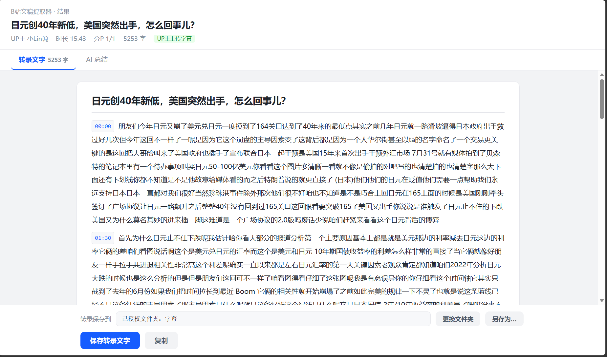
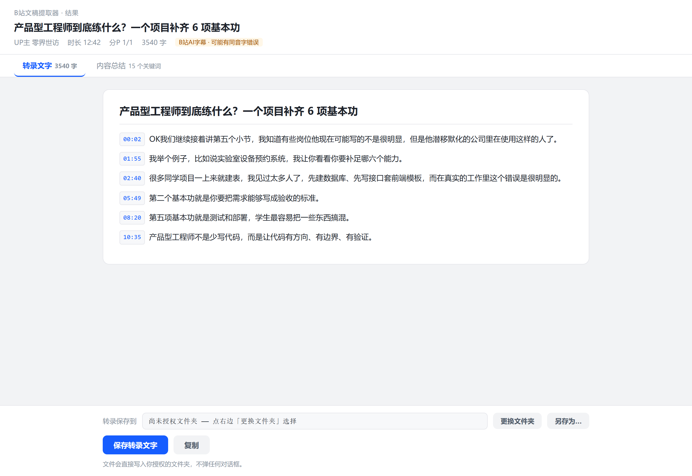
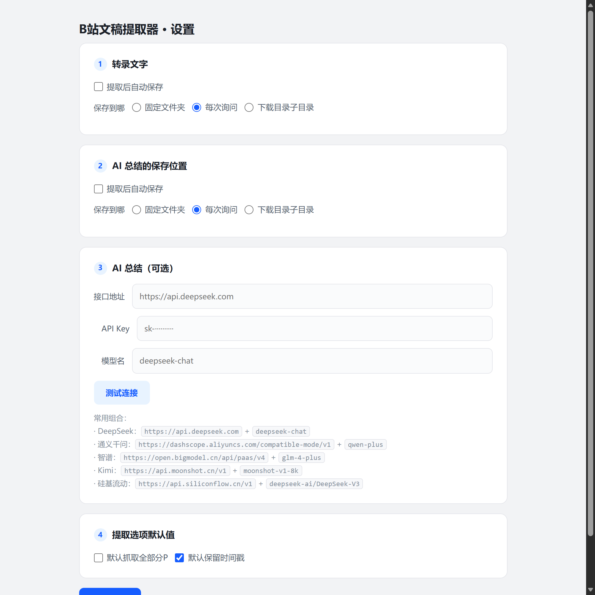

# 视频文稿提取器

浏览器扩展：一键把 **B站 / YouTube** 视频字幕提取成可读文稿，可选接入大模型生成结构化内容总结。

当前优化版：**v1.2.0**。默认输出精简文稿，处理方式和示例见 [精简说明](docs/cleanup.md)，详细变更见 [CHANGELOG.md](CHANGELOG.md)。

- 每次提取使用独立结果快照，多个结果页互不覆盖；本次提取的时间戳选项优先生效。
- 多分P分别整理，保留标题和各自的时间轴；缺失字幕、超过 30P 的情况会在页面明确提示。
- 转录保留短句、重复表述和英文单词间空格；同音词替换仅使用你设置的词典。
- AI 总结支持停止、失败后重试、超时提示，以及当前浏览器会话内的完成结果缓存。



## 功能

- **精简文稿（默认）** —— 本地清理语气词、口头禅、口误重复、重复句与重复问题，显示减少字数和重复次数
- **原始转录** —— 保留提取的原话，补标点、分段，供对照；与精简稿都支持时间锚点
- **AI 总结** —— 把字幕交给大模型，按内容逻辑重组成分节总结（需自行配置接口）
- **中文字幕** —— YouTube 任意字幕轨道可机翻为中文；B站原生支持 AI 字幕 / CC
- **灵活保存** —— 固定文件夹 / 每次询问 / 浏览器下载目录子目录，三种方式独立配置
- **多语言字幕** —— YouTube 支持多语言字幕轨道（人工字幕优先）

## 安装

1. 下载本仓库（Code → Download ZIP，解压）
2. 打开 Edge / Chrome 的扩展管理页（`edge://extensions` 或 `chrome://extensions`）
3. 打开右上角「开发人员模式」
4. 点「加载解压缩的扩展」，选择本仓库的 `extension` 文件夹

桌面升级时，可将新版 `extension` 内的文件更新到原来加载的插件目录，再到扩展管理页点击「重新加载」。如果改用新的文件夹安装，请先停用旧扩展；新扩展实例需要重新配置设置和目录授权。升级后刷新已经打开的视频页面。

结果快照只在当前浏览器会话内保留，最多保存最近 10 次；重启浏览器、重新加载扩展或超出保留范围后，旧结果链接可能过期。需要长期保留的文稿和总结，请使用「保存」导出 Markdown。

## 使用

打开 B站或 YouTube 的视频页，点扩展图标：

- **提取精简文稿** —— 提取字幕后自动在本地清理，默认打开「精简文稿」，可切换「原始转录」核对
- **提取并生成 AI 总结** —— 先精简，再将精简后的正文交给你配置的大模型总结

精简文稿和原始转录分别复制、保存，精简文件名带 `_精简文稿` 后缀。自动保存会保存精简稿，保存位置与原始转录共用。清理语气词和精确重复不需要 API Key；跨句改写和语义上重复的问题由 AI 总结进一步处理。

### YouTube 中文

英文视频勾选「翻译成中文」，扩展会通过 YouTube 的字幕翻译接口生成中文版本。
对部分视频，YouTube 要求字幕必须先在播放器里加载一次 —— 提取失败时按提示
点开播放器的 CC 字幕开关，再点一次提取即可。

## 截图

| 转录文字（B站） | 设置 |
|---|---|
|  |  |

## 手机上使用（Edge for Android）

Edge for Android 支持扩展，但**只能按 crx 文件安装**（移动端不支持加载解压文件夹）：

1. 从本仓库的 [Releases](../../../../releases) 下载 `.crx` 文件
2. 手机 Edge → `···` → 设置 → **关于 Microsoft Edge** → 连续点 5 次版本号
3. 返回设置页，底部出现「**开发人员选项**」→ 点「**Extension install by crx**」→ 选择该文件

**移动端限制**：Android 浏览器没有 File System Access API，所以「固定文件夹」模式不可用
（扩展会自动禁用它）。请改用「每次询问」或「下载目录子目录」。
另外扩展的配置与文稿存在**各设备本地**，手机与电脑互不同步，需分别配置。

## AI 总结配置

设置页 →「AI 总结」，填入任意 OpenAI 兼容接口（三样：接口地址 / API Key / 模型名）：

| 服务 | 接口地址 | 模型名 |
|---|---|---|
| DeepSeek | `https://api.deepseek.com` | `deepseek-chat` |
| 通义千问 | `https://dashscope.aliyuncs.com/compatible-mode/v1` | `qwen-plus` |
| 智谱 | `https://open.bigmodel.cn/api/paas/v4` | `glm-4-plus` |
| Kimi | `https://api.moonshot.cn/v1` | `moonshot-v1-8k` |
| 硅基流动 | `https://api.siliconflow.cn/v1` | `deepseek-ai/DeepSeek-V3` |

不配置也不影响字幕提取 —— 提取和整理全部本地完成，**不联网上传任何内容**。

## 隐私

- 字幕提取与整理全部在本地完成，不经任何第三方服务器
- AI 总结仅在你主动点击时，把字幕文本发送给你自己配置的模型接口
- 扩展不收集、不上传任何使用数据
- API Key 以隐藏输入框显示，保存在本机扩展设置中；扩展阻止内容脚本直接读取这些设置。该存储并非加密保险箱，请仅使用可信的模型接口。
- 字幕翻译由 YouTube 提供；只有主动生成 AI 总结或测试连接时，才会请求你配置的模型服务。

## 开发与验证

无需构建即可加载 `extension`。安装 Node.js 22 或更新版本后，在仓库根目录运行：

```sh
npm run check
npm test
```

这些检查不需要安装依赖，也不会请求真实字幕或付费模型。浏览器集成检查另需本地安装 `playwright` 和 Chromium；也可以通过 `BROWSER_EXECUTABLE` 指定 Edge 可执行文件，然后运行 `npm run test:browser` 和 `npm run test:extension`。后者仅在支持通过启动参数加载扩展的浏览器中可用。

`tests/browser.cjs` 使用模拟 Chrome API 与模型接口检查页面交互；`tests/extension.cjs` 使用独立测试配置加载真实扩展，检查 service worker、设置和结果存储。二者不能代替真实站点联调。

## 免责声明

本项目仅供学习与研究。使用时请遵守 B站、YouTube 的服务条款及相关法律法规，
字幕内容的版权归原作者所有，请勿用于商业用途。

## License

[MIT](LICENSE)
